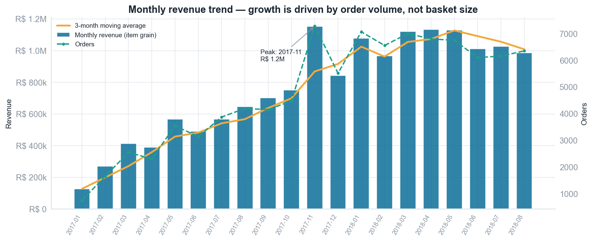
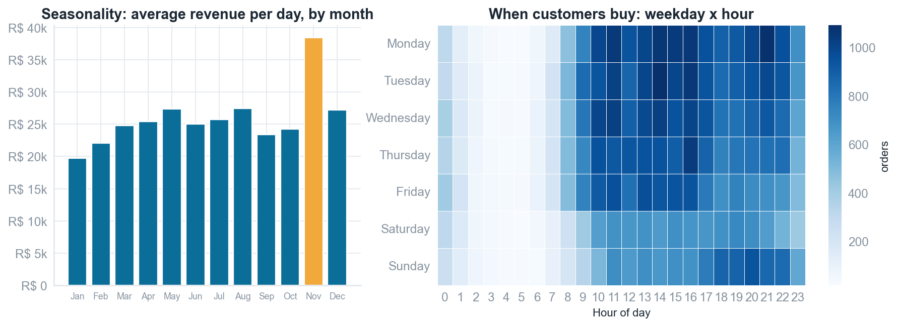
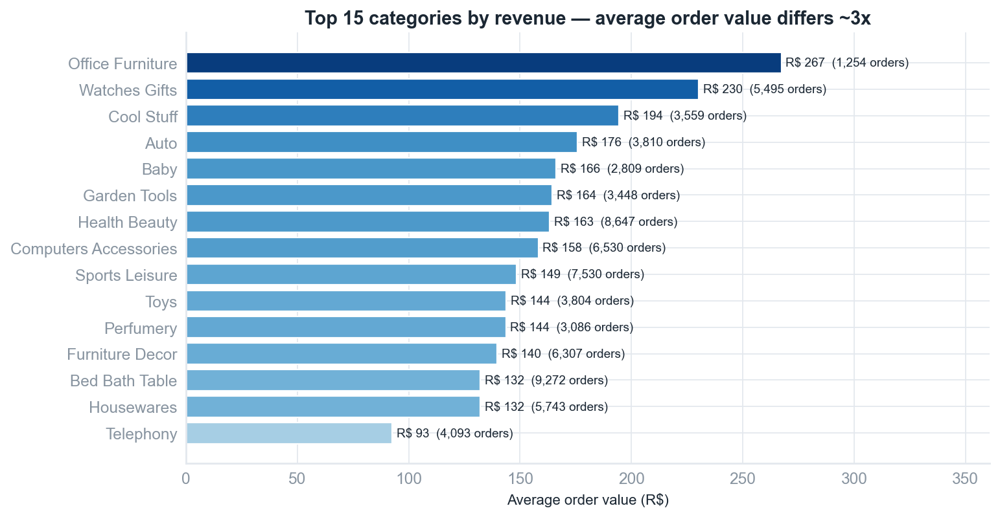
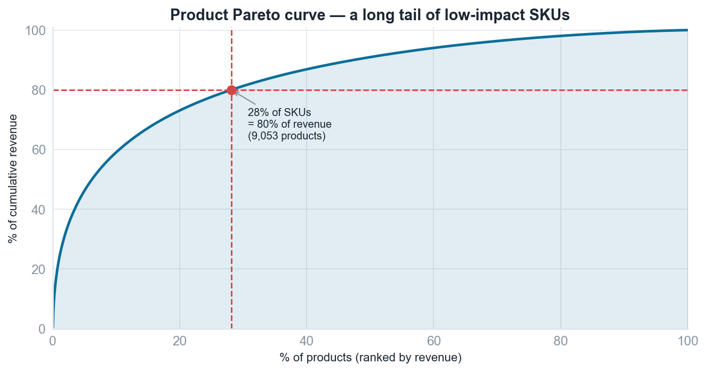
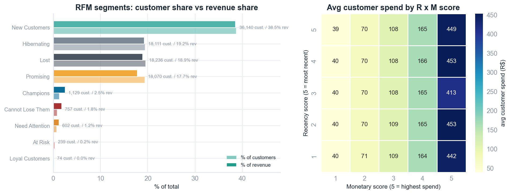
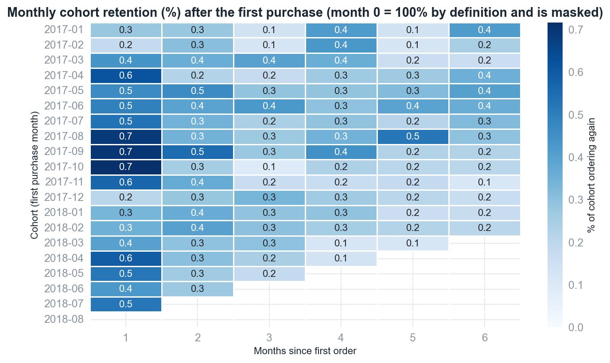
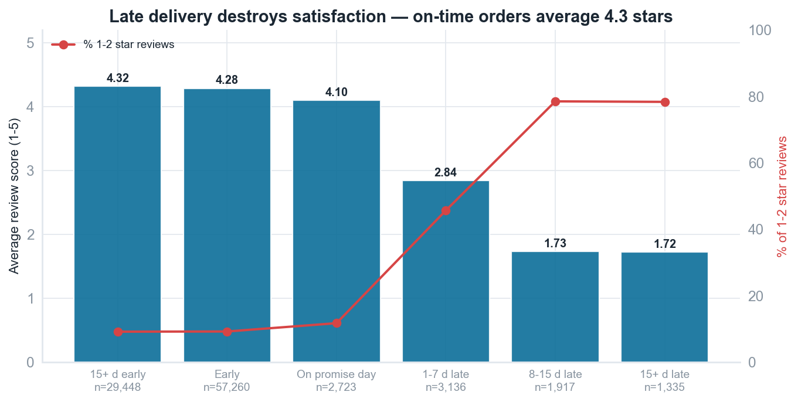
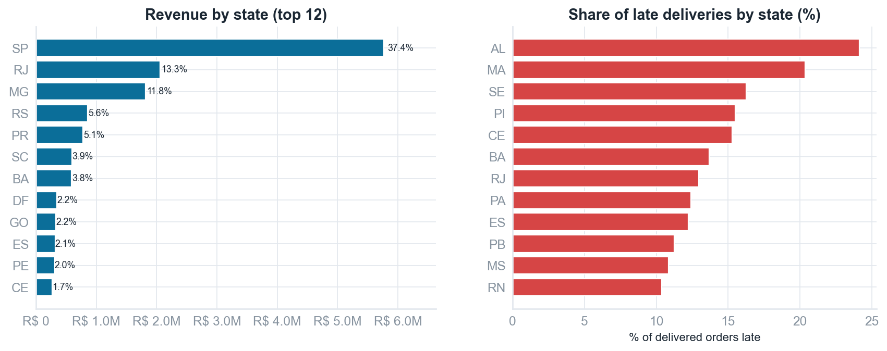

# E-commerce Sales & Customer Behaviour Analysis
### Olist Brazilian E-commerce — 96,478 delivered orders, R$ 15.42M revenue (Sep 2016 – Aug 2018)


## 1. Executive summary

Olist is a Brazilian marketplace. This report analyses 96,478 delivered orders, 110,197 items, 93,358 customers and 95,832 reviews to answer two questions: **how can revenue grow**, and **which customers are actually valuable**.

| KPI | Value | What it means |
|---|---|---|
| Revenue (delivered orders) | R$ 15.42M | gross merchandise value + freight, net of vouchers |
| Orders / Items | 96,478 / 110,197 | 1.14 items per order — almost no basket building |
| Average order value | R$ 159.86 | flat at R$146–170 for 20 months |
| Unique customers | 93,358 | 93,358 people produced 96,478 orders |
| Repeat purchase rate | 3.0% | 97% of customers buy exactly once |
| Revenue from repeat buyers | 5.6% | the base is transactional, not loyal |
| Average review score | 4.16 / 5 | 59.2% five-star, 12.8% one-to-two star |
| Delivery: actual vs promised | 12.6 vs 23.7 days | 91.9% arrive early, 8.1% late |
| Cancelled / unavailable | 1,234 orders (1.2%) | excluded from the revenue universe |


#### Five findings that matter

- **Growth was volume-driven, and the basket never grew.** Revenue rose from R$127k (Jan-2017) to R$1.15M (Nov-2017) — a +806% run — while AOV stayed between R$146 and R$170. The business acquires more orders; it does not sell more per order.
- **The Black Friday peak was a spike, not a new level.** Nov-2017 was +53.6% month-over-month and December fell 26.9%; revenue then plateaued at R$1.0–1.1M per month. The 2018 run-rate is ~4x 2017, but flat since January 2018.
- **There is almost no loyalty to manage.** 97% of customers order once, repeat buyers generate 5.6% of revenue, and monthly cohort retention never exceeds 0.7%. The textbook RFM story ("Champions are 15% of customers and 50% of revenue") is false for this dataset — Champions are 1.2% of customers and 2.5% of revenue.
- **Value is concentrated in individuals, not in segments.** The top 1% of customers by spend generate 10.3% of revenue, the top 5% generate 26.8%, and the top 20% generate 53.5%. The highest-value customers per head (R$339–358) are Champions and "Cannot Lose Them" — 1,886 people worth 4.3% of revenue.
- **Late delivery is the single biggest destroyer of satisfaction.** On-time orders average 4.29 stars; late orders average 2.57 and 54.1% of them become 1–2 star reviews. Lateness is regional: 14.3% in the North-East vs 7.5% elsewhere, peaking at 23.9% in Alagoas.

## 2. Problem, scope and data

**Business problem.** Given 24 months of marketplace transactions, identify where revenue comes from, which customers are worth protecting, and which operational levers would move revenue and reputation.

**Dataset.** The Olist Brazilian E-commerce Public Dataset (Kaggle): nine relational tables — orders, order items, payments, reviews, customers, products, sellers, geolocation and a Portuguese→English category translation. Keys: `order_id` links the fact tables, `product_id` and `seller_id` link catalogue dimensions, `customer_id` links the buyer.

**Two structural traps, both handled deliberately.** (1) `customer_id` is regenerated for every order, so frequency must be measured on `customer_unique_id` — otherwise every customer looks new and the repeat rate collapses to zero. (2) `order_items` is item-grain, so summing order-level values there multiplies revenue; all order KPIs are computed on a one-row-per-order fact table.


## 3. Method


### 3.1 Cleaning

Missing values, duplicates and data types were fixed table by table (implemented in `src/etl.py`):

- eight date columns converted from text to timestamps; impossible timestamps (delivery before purchase) nulled
- payments collapsed from 103,886 rows to 99,440 orders (total value, max installments, dominant payment type)
- 551 duplicate reviews removed, keeping the most recent answer per order
- 1,000,163 geolocation rows aggregated to 19,015 zip-prefix centroids to avoid a join explosion
- 610 products without a category labelled `Unknown`; categories translated to English
- 1,234 cancelled/unavailable orders flagged and excluded from revenue analysis
**Revenue definitions used consistently.** *Order revenue* = `payment_value` (what the customer actually paid, net of vouchers) — used for KPIs, AOV and RFM. *Item revenue* = `price + freight_value` — used for product, category, seller and state cuts. On delivered orders the two agree within 0.02% (R$15,419,774 vs R$15,422,462), which confirms the joins did not fan out.


### 3.2 Analysis techniques

- **SQL (13 queries, `sql/02_analysis_queries.sql`)** — monthly trend with `LAG()` and `SUM() OVER()` running totals, top categories with cumulative share, state performance, delivery vs promise, `RANK() OVER (PARTITION BY state)`, Pareto with `ROW_NUMBER()`/`SUM() OVER()`, RFM with `NTILE()`, and a cohort retention triangle. Runs as shipped on SQLite, portable to MySQL 8 / PostgreSQL 12+.
- **Python EDA** — monthly trend, seasonality, weekday×hour demand, payment mix, review-vs-delay, AOV by category, geography, basket distribution.
- **Advanced analytics** — RFM segmentation (R and M in quintiles, F in explicit 1/2/3+ buckets because quintiles are useless when 97% of customers buy once), monthly cohort retention, and a product Pareto curve.

## 4. Findings


### 4.1 Sales growth and seasonality



*Figure 1 — Monthly revenue and orders. Growth is a staircase of order volume; AOV is flat.*

Revenue grew from R$127k in Jan-2017 to R$1.15M in Nov-2017 (+806%), driven by order volume (750 → 7,289 orders/month) rather than basket size (AOV R$146–170 throughout). The Nov-2017 peak is +53.6% over October and clearly campaign-driven (Black Friday); December gave back 26.9%, and since January 2018 revenue has oscillated in a narrow R$1.0–1.15M band. The 3-month moving average flattens after May-2018, which is the first sign that acquisition growth had stopped compounding.



*Figure 2 — Revenue per active day by month (left) and demand by weekday × hour (right).*

November is the strongest calendar month (~R$38k revenue per day vs ~R$23k in September), so campaign budget belongs there — but the data also shows that a single Q4 spike does not carry the following year. Demand concentrates Monday–Friday between 10:00 and 16:00, with a secondary evening peak on Mondays and Tuesdays: support and paid-media schedules should follow that shape, not the weekend.


### 4.2 Products and categories



*Figure 3 — Top 15 categories by revenue, with average order value.*

The catalogue is broad and shallow: 71 categories, and the top ten are only 62.4% of revenue. Health & Beauty leads with 9.2% (R$1.41M from 8,647 orders), followed by Watches & Gifts (8.2%) and Bed Bath Table (8.0%, the highest order count at 9,272). AOV varies ~2.9x across the top 15 — Office Furniture R$267 vs Telephony R$93 — so equal traffic produces very unequal revenue.



*Figure 4 — Product Pareto: 28.1% of the 32,216 SKUs generate 80% of revenue.*

Revenue concentration is real but not extreme: 9,053 products (28.1%) make 80% of revenue, the top 20% make 73.1%, and the bottom half of the catalogue contributes only 9.0%. The long tail therefore carries inventory, photography and support cost for under a tenth of revenue — a pruning and bundling target, not a growth target.


### 4.3 Customers: RFM, cohorts and repeat behaviour



*Figure 5 — RFM segments: customer share vs revenue share, and average spend by R × M score.*

| Segment | Customers | % customers | % revenue | Revenue / customer |
|---|---|---|---|---|
| New Customers (recent, 1 order) | 36,140 | 38.7% | 38.5% | R$ 164 |
| Hibernating / Lost | 36,347 | 38.9% | 38.1% | R$ 162 |
| Promising (mid-recency, 1 order) | 18,070 | 19.4% | 17.7% | R$ 151 |
| Champions (repeat + recent + high spend) | 1,129 | 1.2% | 2.5% | R$ 339 |
| Cannot Lose Them (high spend, 12m+ absent) | 757 | 0.8% | 1.8% | R$ 358 |
| Need Attention / At Risk / Loyal | 915 | 1.0% | 1.4% | R$ 68–302 |

Two conclusions follow, and they contradict the usual RFM narrative. First, **the segment pyramid is inverted by volume**: 97.0% of customers have a single order, so the population is dominated by one-timers and the "loyalty" segments are tiny. Second, **value is an individual property, not a segment property**: the top 1% of customers by spend produce 10.3% of revenue and the top 5% produce 26.8%, while the Champions segment as a whole is only 2.5% of revenue. A business that manages only segments will miss the 1,886 customers (Champions + Cannot Lose Them) who are worth R$339–358 each, 2.1x the average lifetime value of R$165.



*Figure 6 — Monthly cohort retention. Month 0 is 100% by definition and is masked.*

Cohort retention never exceeds 0.7% in any month after the first purchase, and it decays rather than recovers. Whatever acquisition is doing, it is not producing a returning customer base — consistent with the 3.0% repeat-purchase rate and with a marketplace where the same shopper has little reason to return to a specific seller. Note also the right-censoring: cohorts after 2018-02 have fewer observable months, so the triangle must be read by column, not by row.


### 4.4 Delivery performance and satisfaction



*Figure 7 — Average review score and % of 1–2 star reviews, by delivery delay vs promise.*

This is the strongest relationship in the dataset. Orders delivered early or on the promised day average 4.28–4.32 stars with ~9% bad reviews. One to seven days late and the score drops to 2.84 with 45.8% bad reviews; 8–15 days late gives 1.73 stars and 78.5% bad reviews. Across the whole base, late orders average 2.57 stars vs 4.29 for on-time orders.

Operationally, Olist is not slow — it is unreliable in specific places. Average delivery is 12.6 days against an average promise of 23.7 days, so 91.9% of orders beat the estimate; yet 7,826 orders (8.1%) missed it, with the worst delays reaching 166 days. The gap is regional: the North-East runs a 14.3% late rate against 7.5% elsewhere, led by Alagoas (23.9%), Maranhão (19.7%), Piauí (16.0%) and Ceará (15.3%). In those states the promise is 30.7 days while actual delivery averages 20.0 days — the estimate is padded, which hides the problem from the customer but also destroys credibility when it is missed.



*Figure 8 — Revenue by state (left) and share of late deliveries (right).*


### 4.5 Payments and freight economics

Credit card is 75.4% of orders and 78.4% of revenue, with 3.55 installments on average — installment credit is the default payment behaviour. Boleto (bank slip) is 19.9% of orders but only 18.0% of revenue at R$144 average order value, 13% below credit-card buyers: boleto customers are the price-sensitive segment and the natural target for an installment or small-discount offer. Freight is 14.3% of item revenue overall but 16.5% in Bahia against 12.2% in São Paulo, so distance already taxes the lower-revenue states twice.


## 5. Recommendations

| # | Action | Why (evidence) | Expected impact |
|---|---|---|---|
| 1 | Launch a second-purchase incentive at day 21 after delivery, aimed at the 36,140 New Customers | Cohort retention at month 1 is ~0.4%; New Customers are 38.5% of revenue | 2% conversion ≈ R$118k, 5% ≈ R$296k incremental revenue |
| 2 | Cut the late-delivery rate from 8.1% to 4% in AL, MA, PI and CE (carrier SLA + earlier hand-off) | Late orders average 2.57 stars and 54.1% become 1–2 star reviews | ≈4,900 fewer late orders → ~2,650 fewer bad reviews |
| 3 | Replace padded promises with an achievable SLA in the North-East (30.7 → ~20 days) | Customers are promised 30.7 days and receive 20.0; the padding hides operational failure | Higher perceived reliability at zero logistics cost |
| 4 | Build a VIP list for the 1,886 Champions + Cannot Lose Them (2.0% of customers, 4.3% of revenue) | R$339–358 lifetime value vs R$165 average; 757 high-spend customers already 12m+ absent | 10% frequency lift ≈ R$64k, plus a win-back window before they are unrecoverable |
| 5 | Bundle Bed Bath Table + Housewares (AOV R$132–134, 18,000+ orders) | AOV has been flat for 20 months; the cheapest growth lever is basket size | +10% AOV on those two categories ≈ R$230k/year |
| 6 | Offer boleto installments (or a small boleto discount) | 20% of orders pay by boleto at 13% lower AOV and 1.0 installments | Closes the value gap with credit-card buyers |
| 7 | Freeze new SKUs in the bottom half of the catalogue; reallocate to the top three categories | Bottom 50% of SKUs = 9.0% of revenue; top 10 categories = 62.4% | Lower inventory and content cost, tighter merchandising |

Sequencing matters: actions 2, 3 and 6 are operations/systems changes that need no marketing spend and protect the review score that acquisition depends on. Actions 1, 4 and 5 are revenue plays and should be run as A/B tests, because the base repeat rate is so low that any lift is hard to detect without a controlled test. Action 7 is a slow structural decision about the catalogue.


#### 30 / 60 / 90 day plan

- **30 days** — instrument first-90-day repeat rate; ship the day-21 second-purchase voucher; define the VIP list.
- **60 days** — carrier SLA review for AL/MA/PI/CE; re-promise the North-East; add a late-order recovery email.
- **90 days** — bundle test in Bed Bath Table/Housewares; boleto installment offer; catalogue pruning rules.

## 6. Limitations

- No cost, margin or marketing-spend data, so revenue is analysed but profitability and CAC/ROAS are not.
- No returns table; refunds are only visible through `unavailable`/`canceled` statuses (1.2% of orders).
- 2016-09→12 and 2018-09 are partial months; all trends are restricted to 2017-01→2018-08.
- RFM is a point-in-time snapshot (2018-08-30); recency scores age with the data.
- Cohorts after 2018-02 are right-censored — they have fewer observable months and must not be compared across rows.
- Orders spanning several categories are attributed to their highest-value category in the dashboard, which slightly under-counts secondary categories.

## 7. Reproducibility

The whole pipeline is code, in four commands:

```bash
python -m src.etl                  # raw CSVs → cleaned tables, master table, SQLite warehouse
python -m src.sql_analysis         # executes the 13 SQL queries → reports/sql_results/
python -m src.analysis             # EDA figures, RFM, cohort, Pareto → reports/figures/
python -m dashboard.build_dashboard # interactive HTML dashboard
```

Deliverables: `notebooks/01_olist_analysis.ipynb` (executed, with commentary), `sql/01_schema.sql` + `sql/02_analysis_queries.sql`, `dashboard/olist_dashboard.html` (4 pages, filters, screenshots in `dashboard/screenshots/`), `powerbi/` (star-schema extracts, DAX measures, build guide), and this report.
